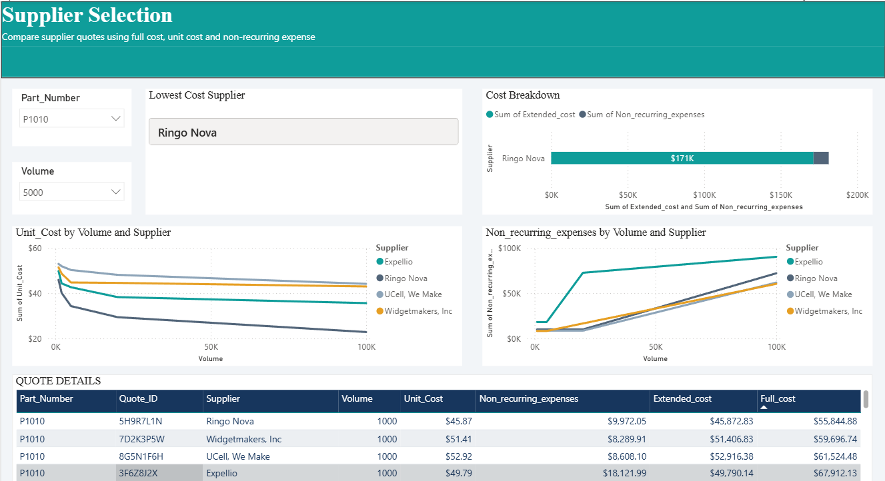
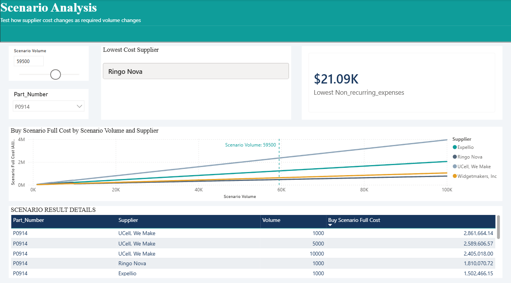
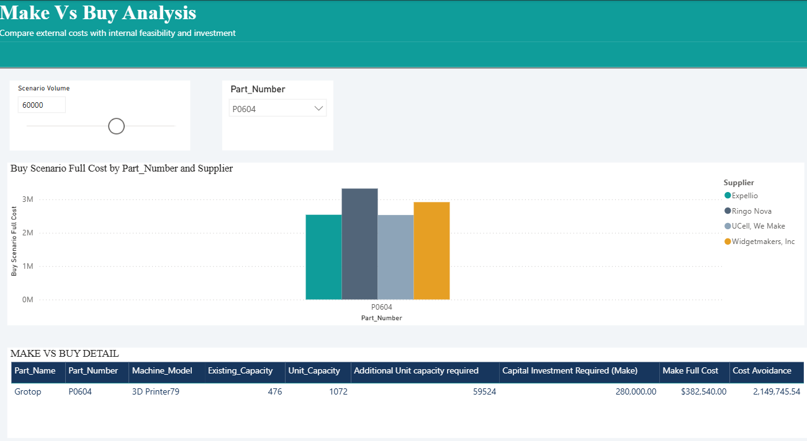

# Make vs. Buy Analysis | Power BI

## Project Overview

Should a business manufacture a product internally or purchase it from an external supplier?

This project explores that procurement decision using Microsoft Power BI. It compares estimated internal manufacturing costs, including required capital investment, with supplier purchasing costs across selected production-volume scenarios.

The objective is to evaluate both alternatives and identify which has the lower estimated cost under the assumptions represented in the model.

## Business Questions

* Which supplier quote is most cost-effective for a particular part and required volume?
* How do modeled costs change when demand assumptions change?
* Does the preferred supplier change at different volumes?
* Is internal production economically attractive and operationally feasible after considering capacity and investment?
* Are cost comparisons based on consistent units, commercial terms, and time horizons?

## The solution

### 1\. Supplier Selection

**Decision question:** Which quote has the lowest comparable full cost for the selected part and volume?

Visible fields include `Part\_Number`, `Quote\_ID`, `Supplier`, `Volume`, `Unit\_Cost`, `Non\_recurring\_expenses`, `Extended\_cost`, and `Full\_cost`.

The intended workflow is to filter to the required part and volume, compare the quote economics, inspect the cost components, and validate the lowest-cost supplier indicator against the detailed quote rows.

### 2\. Scenario Analysis Simulator

**Decision question:** How might the sourcing cost comparison change when required volume changes?

The page includes a scenario-volume selector, part filter, supplier comparison, `Buy Scenario Full Cost`, scenario volume fields, and summary indicators. This provides a framework for testing alternative demand assumptions rather than relying on one static volume.

### 3\. Make vs. Buy Analysis

**Decision question:** How does external purchase compare with internal production when both cost and operational feasibility are considered?

Visible fields include `Machine\_Model`, `Existing\_Capacity`, `Unit\_Capacity`, `Additional Unit capacity required`, `Capital Investment Required (Make)`, `Make Full Cost`, and `Cost Avoidance`, alongside buy-scenario cost information.

## Tools & Methods

**Tool:** Microsoft Power BI

**Key skills demonstrated:**
- Data visualization and interactive dashboard development
- DAX measures for scenario-based cost calculations
- Supplier quote and procurement cost comparison
- Manufacturing capacity and capital investment analysis
- Make-versus-buy cost modelling
- Business interpretation of analytical results

### DAX & Business Logic

I developed DAX measures to evaluate procurement and manufacturing costs under different volume scenarios, including:

- **Buy Scenario Full Cost:** Estimates purchasing cost for the selected scenario volume using eligible supplier quotes, unit cost, yield rate, and non-recurring expenses.
- **Additional Unit Capacity Required:** Estimates the additional manufacturing capacity needed after accounting for existing capacity.
- **Capital Investment Required (Make):** Estimates the investment needed to provide additional manufacturing capacity.
- **Make Full Cost:** Combines estimated capital investment with variable manufacturing costs.
- **Cost Avoidance:** Calculates the absolute difference between the estimated making and buying costs.

The formulas and detailed explanations are documented separately in the [DAX Measures Documentation](./dax-measures/make-vs-buy-measures.md).

## Dashboard Preview

### 1. Supplier Selection
Compare supplier quotes and examine how unit cost, non-recurring expenses, and yield rate influence estimated purchasing costs.

### 2. Scenario Analysis
Explore supplier purchasing costs across selected production volumes and investigate whether the lowest-cost supplier changes between scenarios

### 3. Make vs. Buy Analysis
Compare estimated internal manufacturing costs with supplier purchasing costs to evaluate the cost difference between the two alternatives.

## Key Findings

### 1. The preferred option varies by part

The analysis showed that the more cost-effective option differed across the parts evaluated.

•	P0604: Internal manufacturing had a lower estimated cost at the tested volumes of 15,000, 30,000, and 60,000 units.

•	P0830: Purchasing was cheaper at the tested volumes of 15,000 and 28,000 units.

•	P0914: Internal manufacturing had a lower estimated cost at the tested volumes of 15,000 and 59,500 units.

These comparisons suggest that a single make-or-buy policy may not be appropriate for every part. Product-level cost comparisons can help procurement teams evaluate each decision individually.

### 2. Existing capacity can affect the manufacturing decision

For Part P0914, internal manufacturing had a lower estimated cost than purchasing from the lowest-cost supplier identified in the analysis at both tested volumes.

| Scenario Volume | Make Full Cost | Buy Full Cost | Estimated Cost Difference |
|---:|---:|---:|---:|
| 15,000 units | $14,700.00 | $156,906.54 | $142,206.54 |
| 59,500 units | $58,310.00 | $468,233.48 | $409,923.48 |

At 59,500 units, Ringo Nova had the lowest calculated purchasing cost among the four suppliers compared. The manufacturing estimate was based on a unit production cost of $0.98 and existing capacity of 240,000 units, resulting in no additional capital investment under the model's capacity assumptions.

This example illustrates how existing production capacity can influence make-or-buy decisions. 

### 3. Make vs. Buy: Manufacturing cost advantage at 60,000 units for Part P0604

The initial cost comparison indicates that internal manufacturing may be the more cost-effective option for part P0604 at a selected scenario volume of 60,000 units.

| Measure | Estimated Cost |
|---|---:|
| Make Full Cost | $382,540.00 |
| Lowest Buy Scenario Full Cost | $2,532,285.54 |
| **Absolute Cost Difference** | **$2,149,745.54** |

The manufacturing estimate includes $280,000 in capital investment for additional production capacity and $102,540 in estimated variable production costs. These results suggest that internal manufacturing may be the more cost-effective option under this scenario.

Based on these estimates, internal manufacturing has a substantially lower calculated cost than purchasing from a supplier. This result highlights the importance of evaluating capital investment and production costs alongside supplier quotes when making procurement decisions.

### 4. Supplier Selection Requires More Than Comparing Unit Prices

The Supplier Selection page compares suppliers using unit cost and non-recurring expenses, while the supplier cost calculation also accounts for yield rate.

For part P1010 at a scenario volume of 5,000 units, the Lowest Cost Supplier card identified Ringo Nova. Ringo Nova had a quoted unit cost of $34.29, non-recurring expenses of $9,972 and a yield rate of 83%.

Widgetmakers Inc. had a lower non-recurring expenses of $8,289.91 but higher unit cost of $44.71, and a yield rate of 72%.

Using the project's supplier cost formula, the estimated total cost was approximately $216,538.27 for Ringo Nova and $318,776.02 for Widgetmakers Inc. This represents an estimated difference of $102,237.76 in favor of Ringo Nova for this comparison.

This example demonstrates why supplier selection should consider multiple cost components together rather than ranking suppliers by unit price or one-time expenses alone. 

## Business Interpretation

The results illustrate how production volume, existing manufacturing capacity, supplier yield rates, and non-recurring expenses can influence make-or-buy decisions. 

Three considerations emerged from the scenarios examined:

•	The lower-cost option can vary by part.

•	Existing manufacturing capacity can reduce or eliminate the need for additional capital investment under a given scenario.

•	Supplier purchasing costs depend on more than unit price alone; yield rate and non-recurring expenses also affect the calculated result.
The report provides a structured way to compare alternatives under selected assumptions.

## Repository Contents

- [Power BI Report](./Supply%20chain%20Analysis.pbix) — Interactive Power BI report.
- [DAX Measures and Documentation](./dax-measures/make-vs-buy-measures.md) — Formulas, explanations, and business purpose of the measures.
- [Supplier Selection Screenshot](./screenshots/supplier-selection.png)
- [Scenario Analysis Screenshot](./screenshots/scenario-analysis.png)
- [Make vs. Buy Analysis Screenshot](./screenshots/make-vs-buy-analysis.png)
